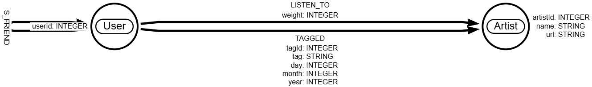

# Part A: Modeling and Loading (Q1 to Q3)

**Sources**
- [README]: dataset README, HetRec 2011 Last.fm 2K, v1.0 (GroupLens)
- [GDS]: Neo4j Graph Data Science Python client, *Datasets* page
- [S5] / [S6]: course slides, Chapter 3, Session 5 (Graph Mining) / Session 6 (Graph Partitioning)

---

## Q1. Main question

> **Using only the friendship graph, can we find groups of Last.fm users who share the same musical taste?**

### Why it is interesting

1. **It is the Karate Club question on real data.** The course asks: *"Using only the friendship graph, can we predict who followed whom?"* [S6, slide 10]. We do the same: we cut the friendship graph into groups, then compare the groups with an independent "truth": the artists users listen to and the tags they use.
2. **Social networks are not random.** If u is linked to v and w, then v and w are more likely to be linked (locality), and social graphs have far more triangles than random graphs [S5, slides 18 and 20]. We test whether this structure comes from musical taste ("birds of a feather flock together").
3. **It has a use case.** If friends share taste, music can be recommended from friends. Our User → Artist graph is the bipartite users–items graph of the course [S6, slide 42].
4. **Both answers are useful.** "Yes" supports friend-based recommendation; "no" means friendships form for other reasons and recommendation should rely on listening data.

### How we answer it (Chapter 3 tools)

| Tool | Part | What it tells us |
|---|---|---|
| Properties: degree, distances, triangles, clustering | B | Does the friendship network have a social structure? |
| Communities: Louvain, Label Propagation, modularity | C | Groups of friends |
| Top artists and tags per community | Q10 | Can each group be named by a music genre? |
| Betweenness | Q7, Q11 | Users who bridge two groups |
| Similarity: common neighbours, random walk with restart | D2, E | Do friends share more artists than random pairs? |

### Studied graph

Parts B and C use the **friendship network** (`IS_FRIEND`). Listening (`LISTEN_TO`) and tags (`TAGGED`) are used to **interpret** the results. It is undirected and unweighted (easy to interpret) and has fewer than 2,000 nodes (Part D1 remains possible).

---

## Q2. The network

### Nodes

| Label | Meaning | Count | Properties |
|---|---|---|---|
| `User` | a Last.fm user | 1,892 | `userId` |
| `Artist` | a singer or band | 17,632 | `artistId`, `name`, `url` |

- Counts: [README], *Data statistics*.
- Users are anonymous: *"The users' names and other personal information in Last.fm are not provided"* [README]. We describe users by what they listen to.

### Edges

| Type | From → To | Meaning | Properties | Count |
|---|---|---|---|---|
| `IS_FRIEND` | User – User | friendship | none | 12,717 |
| `LISTEN_TO` | User → Artist | the user listened to the artist | `weight` = listening count | 92,834 |
| `TAGGED` | User → Artist | the user put a tag on the artist | `tagId`, `tag`, `day`, `month`, `year` | 184,941 |

- Columns: [README], *Data format*. Type names and meaning of `weight` and `tagID`: [GDS].
- `tag` (the word, e.g. "metal") comes from `tags.dat`; we store it on the edge to name communities in Q10.

### Directed? Weighted?

The graph is **heterogeneous** (2 node types, 3 edge types):

| Edge | Directed | Weighted | Why |
|---|---|---|---|
| `IS_FRIEND` | no | no | *"bi-directional user friend relations"* [README]; friendship is the course example of an undirected graph [S5, slide 8] |
| `LISTEN_TO` | yes | yes | the user listens to the artist; weight = listening count [README], [S5, slide 10] |
| `TAGGED` | yes | no | the user tags the artist; one edge per tag, so parallel edges are normal [GDS] |

**Studied graph (Parts B, C):** the friendship network, undirected and unweighted. The User → Artist graph is **bipartite**.

### Schema



```
(:User {userId})-[:IS_FRIEND]-(:User)
(:User)-[:LISTEN_TO {weight}]->(:Artist {artistId, name, url})
(:User)-[:TAGGED {tagId, tag, day, month, year}]->(:Artist)
```

### What would be lost with a single table?

| Lost | Why | Source |
|---|---|---|
| Information in the links | In a table, rows are independent; in a graph the information is in the links between rows. | [S5, slide 2] |
| Compactness | One table (user, friend, artist, count, tag, date) combines all relations of a user: ≈ 49 artists × 13.4 friends × 98.6 tags ≈ 65,000 rows per user, **> 100 million rows**, vs ≈ 19,500 nodes and 290,000 edges. | Averages from [README]; product = our estimate |
| Consistency | A friend and an artist are unrelated: the same row creates fake associations or empty cells. | |
| Multi-hop questions | "Artists listened to by friends of friends" = several self-joins in SQL, one pattern in Cypher: `(u)-[:IS_FRIEND*2]-(f)-[:LISTEN_TO]->(a)`. | [S5, slide 3] |
| Triangles and communities | *"A triangle … is not stored anywhere, we have to find it."* Same for communities and bridges. | [S5, slide 20] |

---

## Q3. Loading into Neo4j

Scripts: `src/clean_text_files.py`, then `cypher/01_create_constraints.cypher` and `cypher/02_load_data.cypher`.

### Method

- `LOAD CSV ... FIELDTERMINATOR '\t'`: the HetRec files are tab-separated.
- **Uniqueness constraints** on `userId` and `artistId`: one node per id, and an index so that `MERGE` is fast.
- **`MERGE` instead of `CREATE`**: a node or edge is created only if it does not exist yet, so no duplicates are created.

### Before → cleaning → after

| Element | Before (file) | Cleaning | After (Neo4j) |
|---|---|---|---|
| Artists (`artists.dat`) | 17,632 lines | 16 names contain `"` (e.g. `Weird Al" Yankovic`), which made `LOAD CSV` fail: file rewritten as standard CSV, **no value changed** | **17,632** `Artist` |
| Users | 1,892 [README] | none | **1,892** `User` |
| Tags (`tags.dat`) | 11,946 lines | Latin-1 encoding converted to UTF-8; used as a lookup table (tag number → word), then deleted | 0 nodes (the word is stored on `TAGGED`) |
| Friendships (`user_friends.dat`) | **25,434** lines | Every friendship is written twice (2→275 and 275→2): **one edge per pair** kept; 0 self-loops | **12,717** `IS_FRIEND` |
| Listening (`user_artists.dat`) | **92,834** lines | none (0 duplicates) | **92,834** `LISTEN_TO` |
| Tag assignments (`user_taggedartists.dat`) | **186,479** lines | **1,538** lines (0.8%) point to artists missing from `artists.dat`: ignored; 0 duplicates | **184,941** `TAGGED` |
| **Total** | | | **19,524 nodes, 290,492 edges** |

### Duplicates, self-loops, isolated nodes (final checks)

| Check | Result |
|---|---|
| Duplicate edges | 0 |
| Self-loops | 0 |
| Isolated nodes | 0 |
| Users without a friend | 0 |
| Artists without a name | 0 |
| Artists never listened to | 0 |

### Justification of the cleaning

- **Friendship duplicates:** keeping both directions would double every degree and make m = 25,434. The random-graph comparison of Q6 uses p = m / (n(n−1)/2), and the expected number of triangles grows with p³: it would be 8 times too large.
- **Quotes and encoding:** only the file format changed, not the values (still 17,632 artists and 11,946 tags).
- **1,538 tag lines:** an artist with no name cannot be interpreted, and these lines do not affect the friendship network. Q10 uses 99.2% of the tags.

### Filtering / sampling

No sampling: the whole friendship network is analysed. **Studied graph: n = 1,892, m = 12,717.**

**Limitation:** all 1,892 users have at least one friend, so the dataset was probably built around a connected group of users (the README does not say how users were selected). Our conclusions apply to this sample, not necessarily to all Last.fm users.
