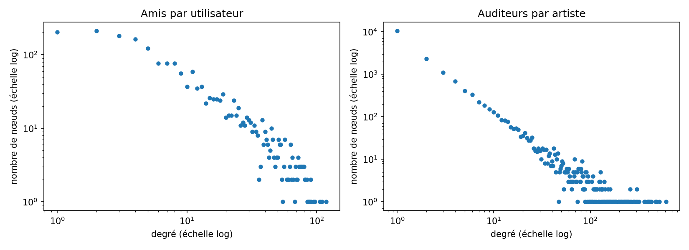

# Partie B : Propriétés du graphe (LastFM)

Réseau étudié : 1 892 utilisateurs, 17 632 artistes, relations `LISTEN_TO` (92 834), `IS_FRIEND` (12 717) et `TAGGED` (184 941).

---

## Q4. Distribution des degrés

Nous étudions trois degrés :
- le nombre d'amis par utilisateur (relation `IS_FRIEND`, non dirigée) ;
- le nombre d'auditeurs par artiste (degré entrant de `LISTEN_TO`) ;
- le nombre d'artistes écoutés par utilisateur (degré sortant de `LISTEN_TO`).

### Tableau 1 : statistiques de degré

| Degré | Moyenne | Médiane | Maximum |
|---|---|---|---|
| Amis par utilisateur | 13,44 | 6 | 119 |
| Auditeurs par artiste | 5,27 | 1 | 611 |
| Artistes écoutés par utilisateur | 49,07 | 50 | 50 |

### Figure 1 : distribution des degrés (échelle log-log)

### Tableau 2 : top 10 des utilisateurs par nombre d'amis

| Rang | Utilisateur | Amis |
|---|---|---|
| 1 | 1543 | 119 |
| 2 | 1281 | 110 |
| 3 | 831 | 106 |
| 4 | 179 | 97 |
| 5 | 1503 | 95 |
| 6 | 1023 | 91 |
| 7 | 1895 | 90 |
| 8 | 405 | 90 |
| 9 | 1300 | 89 |
| 10 | 390 | 88 |

### Tableau 3 : top 10 des artistes par nombre d'auditeurs

| Rang | Artiste | Auditeurs |
|---|---|---|
| 1 | Lady Gaga | 611 |
| 2 | Britney Spears | 522 |
| 3 | Rihanna | 484 |
| 4 | The Beatles | 480 |
| 5 | Katy Perry | 473 |
| 6 | Madonna | 429 |
| 7 | Avril Lavigne | 417 |
| 8 | Christina Aguilera | 407 |
| 9 | Muse | 400 |
| 10 | Paramore | 399 |

### Interprétation

- **Amis.** La moyenne (13,4) est plus du double de la médiane (6) : quelques utilisateurs très connectés tirent la moyenne vers le haut. Le plus connecté a 119 amis, soit environ 9 fois la moyenne. Sur le graphique log-log, la courbe descend de façon presque linéaire : beaucoup d'utilisateurs ont peu d'amis, très peu en ont beaucoup.
- **Artistes.** L'inégalité est très forte. La médiane est de 1 auditeur pour une moyenne de 5,27, et 10 679 artistes sur 17 632 (60,6 %) ne sont écoutés que par une seule personne. À l'inverse, Lady Gaga atteint 611 auditeurs, environ 116 fois la moyenne. Le top 10 est dominé par des artistes pop très grand public.
- **Hubs.** Les deux réseaux sont dominés par un petit nombre de hubs : quelques utilisateurs très sociaux et quelques artistes très populaires, sur une longue traîne de nœuds peu connectés.

### Limites

- La médiane de 50 artistes écoutés par utilisateur confirme que le jeu de données est plafonné au top 50 de chaque utilisateur. Ce degré sortant est donc artificiel et ne mesure pas la diversité réelle des goûts.
- Un hub d'amitié n'est pas forcément un hub d'écoute : le lien entre les deux reste à tester.

---

## Q5. Distances

Le calcul porte sur le réseau d'amitié (1 892 utilisateurs, 12 717 amitiés).

| Mesure | Valeur |
|---|---|
| Composantes connexes | 20 |
| Taille de la plus grande | 1 843 (97,4 %) |
| Tailles suivantes | 7, 4, 3, 3 |
| Diamètre (plus grande composante) | 9 |
| Distance moyenne | 3,52 |
| Distance moyenne attendue (graphe aléatoire, ln n / ln k) | 2,87 |

### Interprétation

- **Composantes.** Le réseau est presque entièrement connecté : 97,4 % des utilisateurs appartiennent à une seule composante. Les 19 autres sont de minuscules groupes (2 à 7 personnes) coupés du reste.
- **Petit monde.** Deux utilisateurs de la plus grande composante sont séparés en moyenne par 3,5 amitiés seulement, alors que le réseau compte 1 843 personnes. C'est la signature d'un réseau "petit monde". Le diamètre de 9 reste modeste et vient de quelques chemins très longs en périphérie.
- **Comparaison au hasard.** Un graphe aléatoire de même taille aurait une distance moyenne de 2,87. Notre valeur est un peu plus grande, ce qui est normal : dans un vrai réseau social, les amis se regroupent en cercles, ce qui allonge légèrement les chemins entre cercles éloignés.

### Limite

Les distances sont calculées sur la seule plus grande composante : les 49 utilisateurs hors de cette composante ne sont pas pris en compte. La formule aléatoire est une approximation.

---

## Q6. Triangles

Le calcul porte sur le réseau d'amitié (1 892 utilisateurs, 12 717 amitiés). Le comptage Python (networkx) a été vérifié par une requête Cypher : les deux donnent 19 690 triangles.

| Mesure | Réseau réel | Graphe aléatoire (mêmes n et m) |
|---|---|---|
| Triangles | 19 690 | 404,9 |
| Clustering moyen | 0,1865 | 0,0071 |
| Transitivité globale | 0,1338 | 0,0071 |

Le graphe aléatoire a une densité p = 0,00711. Le nombre de triangles attendu est C(n,3) × p³, et le clustering attendu est égal à p.

### Interprétation

- **Beaucoup plus de triangles que le hasard.** Le réseau contient environ 49 fois plus de triangles qu'un graphe aléatoire de même taille. Les amitiés ne sont donc pas placées au hasard : les amis d'un utilisateur ont tendance à être amis entre eux.
- **Clustering élevé.** En moyenne, 18,7 % des paires d'amis d'un utilisateur sont elles-mêmes amies, contre 0,7 % dans un graphe aléatoire. Cela indique des cercles d'amis soudés.
- **Réseau petit monde.** Avec les résultats de la Q5 (distance moyenne de 3,5), ces cercles très groupés mais reliés par des chemins courts correspondent exactement à un réseau "petit monde".
- Le clustering des utilisateurs de 1 à 3 amis est peu fiable : avec si peu de paires possibles, il vaut souvent 0 ou 1 par construction.

### Limite

Un graphe aléatoire de même densité est une référence simple : elle ignore que les degrés sont très inégaux (voir Q4). Un modèle qui conserve la distribution des degrés donnerait une référence plus juste, avec probablement plus de triangles que 405.

---

## Q7. Betweenness

## Q7. Betweenness

La betweenness (normalisée) est calculée sur le réseau d'amitié. Elle mesure la part des plus courts chemins entre deux utilisateurs qui passent par un utilisateur donné.

### Tableau 4 : top 10 par betweenness

| Rang | Utilisateur | Betweenness | Amis | Clustering |
|---|---|---|---|---|
| 1 | 1543 | 0,0665 | 119 | 0,031 |
| 2 | 1281 | 0,0545 | 110 | 0,034 |
| 3 | 831 | 0,0487 | 106 | 0,051 |
| 4 | 1258 | 0,0430 | 86 | 0,031 |
| 5 | 78 | 0,0293 | 81 | 0,022 |
| 6 | 1213 | 0,0242 | 68 | 0,101 |
| 7 | 1130 | 0,0238 | 57 | 0,038 |
| 8 | 1503 | 0,0232 | 95 | 0,109 |
| 9 | 298 | 0,0231 | 79 | 0,054 |
| 10 | 1597 | 0,0218 | 70 | 0,037 |

### Interprétation

- **Mêmes nœuds que les hubs ? En grande partie.** La corrélation entre degré et betweenness est forte (Spearman = 0,825), et l'utilisateur 1543 est n°1 dans les deux classements. Pourtant, seulement 4 nœuds sur 10 sont communs aux deux top 10 (831, 1281, 1503, 1543).
- **Des ponts qui ne sont pas des hubs.** Plusieurs utilisateurs sont des ponts sans être parmi les plus connectés : l'utilisateur 1130 est 7e en betweenness avec 57 amis seulement. À l'inverse, des utilisateurs de grand degré, comme 179 (97 amis) ou 1023 (91 amis), n'apparaissent pas dans le top 10 des ponts.
- **Rôle de ces nœuds.** Leur clustering moyen est d'environ 0,05, bien en dessous de celui du réseau (0,187) : leurs amis se connaissent peu entre eux. Cela cohérent avec un rôle de passerelle entre des cercles d'amis différents, comme le suggérait la Q6.
- **Pas de pont unique.** Le meilleur score est de 0,0665 : au plus 6,7 % des plus courts chemins passent par un même utilisateur. Le réseau ne dépend donc pas d'un seul point de passage.

### Limite

La betweenness est calculée sur le seul réseau d'amitié, sans tenir compte des goûts musicaux. Les utilisateurs sont anonymes (seulement un identifiant), ce qui limite l'interprétation de leur rôle. Le rôle de passerelle entre cercles sera vérifié avec les communautés en Partie C (Q11).
